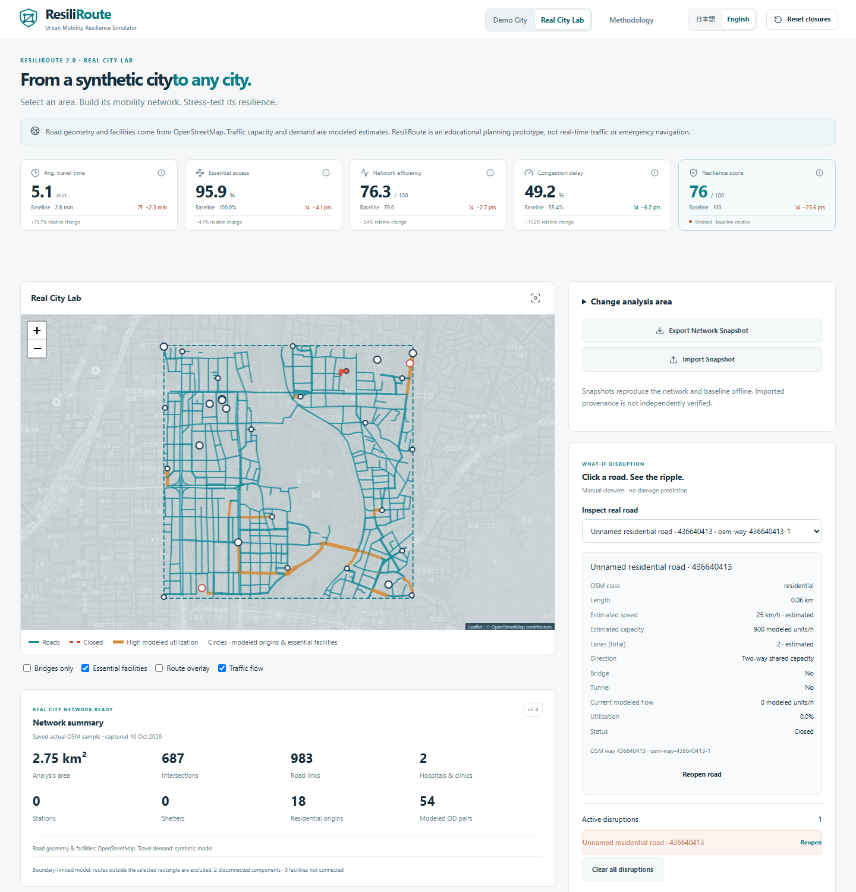
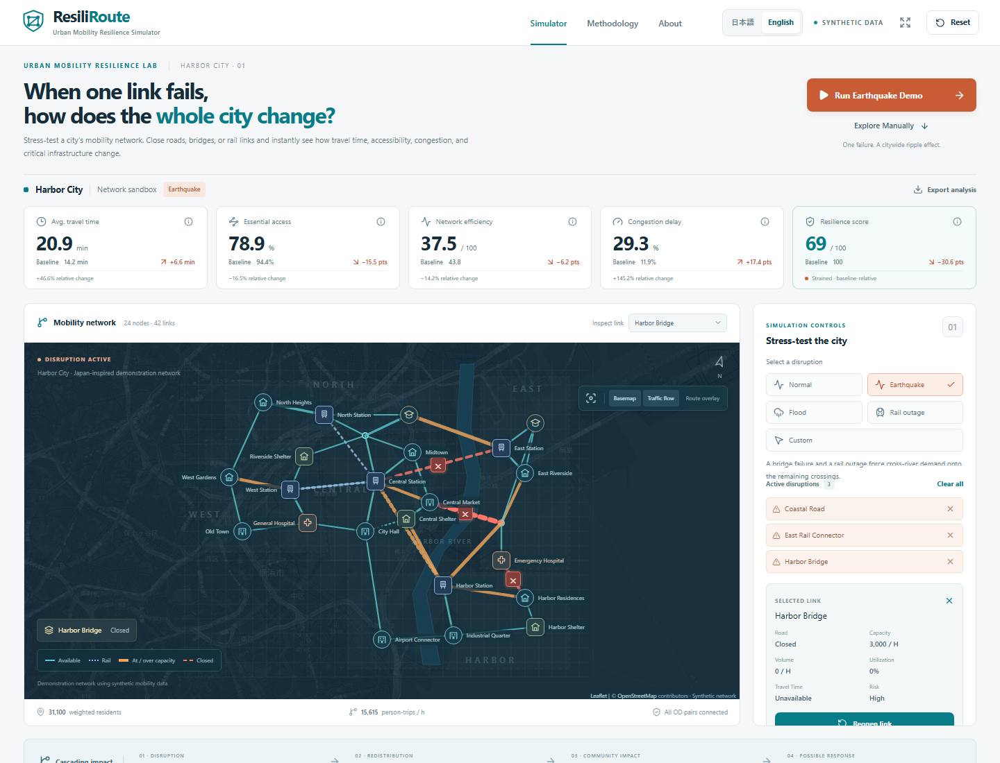
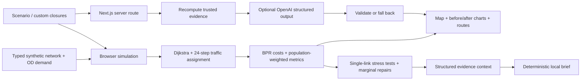

# ResiliRoute

**Urban Mobility Resilience Simulator**

Current source repository: [Dondokopafupafu/resiliroute](https://github.com/Dondokopafupafu/resiliroute).

This repository starts from a reviewed version 3.0 source snapshot. Earlier development history and rollback checkpoints are retained locally rather than included in this public history. [Project evolution](CHANGELOG.md) records the earlier ImpactHack version and subsequent development; publication as a new snapshot does not make the project new work.

_When one link fails, how does the whole city change?_

ResiliRoute is an educational civic-tech application for understanding **cascading transportation failures**. Explore the preserved **Harbor City Demo**, or build a real road network in **Real City Lab**. Demand redistributes, congestion changes, essential services become harder to reach, and recovery options can be compared.

## Ultimate Resilience · version 3.0

**Analyze → Understand → Compare → Recover.** ResiliRoute now includes a shared decision workspace for both city modes: an **Urban Mobility Resilience Decision Support Platform**, built as an educational planning prototype.

### Core capabilities

- **Multi-disruption:** stage up to 12 roads, bridges or rail links, apply together, restore individually or restore all. The original scenario presets and Earthquake Demo remain available.
- **Critical infrastructure:** map traffic, normalized criticality or cascading stress; inspect the original criticality components and deterministic explanations. Before/After switches the map without changing the active scenario. Unscreened roads are explicitly untested.
- **Equity and facilities:** compare Harbor districts or four neutral spatial analysis zones; identify access-loss disparity, affected OD pairs, congested-route exposure and individual facility catchments. Missing facilities remain N/A.
- **Compare and save:** keep up to four named scenarios per network in this browser. Compare metrics and severity, reload, export or import validated scenario JSON. Network/model/demand fingerprints prevent applying a scenario to a different graph. Imported metric values are never trusted.
- **Budget recovery:** set relative costs and a resource budget; choose resilience, accessibility, travel time, efficiency or a disclosed balanced preference. Compare up to three distinct repair sets and apply a plan. Inspect benefit per cost and a modeled recovery-stage sequence.
- **Uncertainty:** independently sample user-defined failure probabilities with a reproducible seed. Inspect a resilience histogram, mean/median/P10/P90, threshold probabilities and worst sampled metrics. Compare shortlisted recovery plans on the same draws by average or worst sampled resilience.
- **Reports:** download bilingual, self-contained print HTML with SVG network geometry, metrics, zones, facilities, critical links, completed recovery/uncertainty evidence and limitations. Open the HTML and choose browser **Print → Save as PDF**. Export five CSV tables or an allowlisted analysis JSON bundle.
- **Presentation:** a focused decision-workspace display, four-step guide, keyboard tabs and Japanese/English labels. Calculations report actual progress, run in a cancellable worker and invalidate stale results when inputs change.

### Recovery optimization and uncertainty

Recovery costs are **relative points**, never currency or repair-duration estimates. Defaults are configurable: bridge/rail 5; motorway/trunk 4; primary 3; secondary/tertiary 2; other/residential 1. Every plan reruns the unchanged simulation. Exact enumeration supports up to 12 closures for ≤80 graph edges, 8 for ≤200 and 6 for larger networks. Larger jobs use a bounded beam search and visibly report approximation. A no-repair option is always considered. Fewer than three feasible distinct plans produce fewer results.

Balanced uses 40% normalized resilience, 30% normalized accessibility, 20% baseline/current travel-time retention and 10% efficiency retention. All terms are bounded to [0,1]. These preferences deliberately overlap; they are not independent scientific dimensions. Recovery-stage order maximizes cumulative resilience across the chosen plan using subset dynamic programming through eight repairs, then a disclosed greedy approximation. It does not optimize real construction schedules.

Monte Carlo supports at most **1,000 / 300 / 100** runs for the same small/medium/large graph bands. The UI samples the union of active and staged links; other links remain available. Probabilities are **user assumptions**, independent across links, not predicted infrastructure hazards. Percentiles describe the experiment rather than calibrated confidence intervals. Robust comparison protects restored links within these hypothetical samples and compares the current top-three shortlist; it does **not** search all robust plans or guarantee the sampled worst case.

### Equity and reporting

The zone diagnostic combines 50% accessibility loss in points, 30% relative travel-time increase capped at 100%, and 20% additional disconnected-demand share. Improvements count as zero loss. The impact gap is the maximum minus minimum zone diagnostic, and access disparity is the spread of nonnegative access losses. These are transparent diagnostics, not validated demographic or social-equity indices. Real-city zones A–D are a 2×2 spatial grid with empty origin zones omitted.

Scenario collections stay in localStorage; no account is required. Scenario files are limited to 128 KiB and validated against version, graph/demand/model identity and known link IDs. A **network snapshot** contains Real City inputs; a **saved scenario** restores closures on an existing matching network; an **analysis snapshot** exports evidence for review. They are distinct formats. Analysis JSON is an export, not a new all-in-one import format. No filenames, credentials or account state are embedded in exports. User-entered scenario names are included, so avoid personal text when sharing a report.

See [technical upgrade record and 90-second/5-minute demo flows](docs/ULTIMATE_UPGRADE.md), [project evolution](CHANGELOG.md), and [verification record](docs/ULTIMATE_QA.md).

```text
OSM / Synthetic Network
          ↓
Network Builder → Graph + OD Demand
          ↓
Shared Simulation: Routing + Assignment + Bounded Congestion
          ↓
Impact Metrics → Criticality / Equity / Facility Access
          ↓
Decision Worker: Compare / Budget Recovery / Sequence / Uncertainty
          ↓
Evidence Explanations + Existing AI Brief + Reports
```

## Real City Lab · version 2.0

**From a synthetic city to any city.** Real infrastructure geometry + modeled mobility demand.

Open **Real City Lab** in the header. Click **Select area on map**, then two opposite corners, or select an example area. **Build Mobility Network** retrieves OSM through `/api/osm/network`; it never sends a heavy Overpass query directly from the browser. Review the network summary and baseline. Click a road, choose **Simulate closure**, then compare rerouting, before/after KPIs, real facilities, critical-road tests and independent recovery gains. **Reset closures** keeps the imported network and restores its baseline. **Demo City** always opens the original simulator.

The recommended rectangle is **1–10 km²**, with a **25 km²** area limit. Dense areas may require a smaller rectangle: limits are 25,000 raw OSM nodes, 900 simplified road nodes, 1,400 road segments and 35 connected facilities. Coordinates are validated on both client and server before any query. Routes leaving the rectangle are excluded, so boundary selection can materially affect results.

### What is real, estimated and synthetic?

| Input                                                                          | Source / interpretation                                                                                                   |
| ------------------------------------------------------------------------------ | ------------------------------------------------------------------------------------------------------------------------- |
| Road shape, shared intersection IDs, road class, direction, bridge/tunnel tags | OpenStreetMap                                                                                                             |
| Hospitals, clinics, stations, tagged shelters, schools                         | OpenStreetMap; incomplete coverage is possible                                                                            |
| Speed                                                                          | Parsed `maxspeed` (including mph), otherwise road-class defaults                                                          |
| Lanes                                                                          | OSM tags when usable, otherwise road-class defaults                                                                       |
| Capacity                                                                       | Estimated per-lane model capacity × total lanes; a two-way edge shares this aggregate                                     |
| Facility connector                                                             | Modeled connection to nearest graph node within 350 m, not a verified entrance                                            |
| Origins and weights                                                            | Deterministic spatial samples; adjacent residential road length is a demand proxy, not census population                  |
| OD flows                                                                       | Synthetic, normalized to `0.75 × median shared road capacity × sampled origin count`, capped at 40,000 modeled units/hour |
| Accessibility                                                                  | Demand-proxy-weighted reachability, not observed access or safety                                                         |

The UI includes measured speed/lane/name tag coverage and a **Data & assumptions** table. Legacy `populationWeight` fields store a relative demand proxy in real-city snapshots. No real population, observed traffic, physical condition, damage probability or safety is inferred. Clinics share the clearly labeled hospital/clinic accessibility category. Missing service categories are **Unavailable**, excluded from its average. With no essential-service categories, access displays **N/A** and its resilience-retention term remains neutral.

### Import, simulation and performance

Ways split at shared intersections, branching points and endpoints. Degree-two shape nodes inside each road are removed from topology while their polyline geometry is retained. Different OSM ways can still retain degree-two endpoints. Crossing lines with different OSM node IDs are never joined. One-way `yes`, `-1`, implicit motorway/roundabout direction and explicit `no` are supported. Road distance is the sum of Haversine distances along its geometry. Only in-bounds node runs with at least two points are retained; boundary crossings are not interpolated.

The adapter feeds the **same** Dijkstra, 24-iteration assignment, bounded BPR, accessibility, efficiency, resilience and recovery functions as Harbor City. A binary heap and batched searches per origin accelerate routing without changing the Harbor City audit results. Real-city simulations and stress tests run in a cancellable **Web Worker**. Available road networks with up to 200 segments receive an exhaustive next-link test. Larger ones screen **35 candidates** using assigned flow × free-flow time, bridge tags and endpoint degree; the full existing model runs for each candidate. The displayed count discloses screening. An unscreened important road can be missed. Facility connectors are excluded from road closures and rankings. Up to 12 simultaneous closures can be compared.

### Overpass dependency and failure handling

The server validates the query, bounds the response size, aborts timed-out/disconnected requests and tries at most three upstream requests (primary, one retry, fallback). A 20-minute process-local cache stores at most 16 rounded bounds; both query and cache key use the same rounded coordinates. A per-process budget of 16 uncached builds per five minutes and two concurrent imports limits accidental pressure. These controls are for a small prototype; distributed public hosting needs a shared cache/rate limiter. No arbitrary client query or client-supplied upstream URL is accepted. No bounds, user identifiers or raw upstream errors are logged by the application.

Optional server environment variables:

```dotenv
OVERPASS_API_URL=https://overpass-api.de/api/interpreter
OVERPASS_FALLBACK_URL=https://overpass.kumi.systems/api/interpreter
```

Overpass is a public service and can be busy. Errors remain visible; **Use Demo City Instead** returns to the independent Harbor City experience. No fake city is silently substituted.

For local use, keep `pnpm dev` or `pnpm start` running while using the app. An already-rendered map can remain visible after the server stops, but new imports require the server. Connection failures show a ResiliRoute-server error, separately from an actual Overpass outage. If an import exceeds road-complexity limits or times out, **Shrink selected area** halves both width and height around the same center. Review the smaller rectangle and press **Build Mobility Network** again; shrinking alone makes no API request and preserves the last successful network.

### Reproducible snapshots and contest demos

**Export Network Snapshot** saves sanitized JSON with bounds, OSM timestamp/attribution, model version **1.0**, graph geometry, facilities and synthetic OD inputs. **Import Snapshot** validates references, sizes and numeric ranges before rerunning the model offline. Snapshots contain no API credentials. Imported provenance is file-supplied and not independently verified. A snapshot represents model inputs and resets to baseline; it does not preserve an active closure scenario.

**Load a saved OSM example (no API)** opens actual OSM snapshots retrieved on **10 October 2026**, explicitly labeled as saved data: Okayama (687 decision nodes / 983 road segments) and Matsumoto (508 / 700). This is an offline replay, not a simulated live API call. Local measured complete stress-test calculations were approximately 5–9 seconds on these samples after routing batching; hardware and topology affect timing. Baseline and scenario KPIs appear earlier while the worker continues ranking. Tiles require connectivity; graph rendering and calculation do not.

### Real-city analyst and privacy

The local analyst produces bilingual structured briefs from calculated evidence, including the most affected modeled origin, imported facilities, additional-link criticality and recovery. It is deterministic, not an LLM. **Optional cloud AI** is off by default. With a server-only `OPENAI_API_KEY`, enabling it sends the validated network and modeled scenario to `/api/analysis/real-city`. The server recalculates evidence, applies a bounded process budget/cache and reuses the schema-validated OpenAI Responses pipeline. Prompts prohibit inference of population, disaster probability, infrastructure condition, demographics or real-world safety. Invalid output or API failure leaves the local brief available. Live paid LLM output is not claimed as verified by mocked provider tests.

No geolocation permission is requested. Selected bounds are sent to the server when explicitly building a network, then to the configured Overpass service. Enabling cloud AI additionally sends network/model evidence to the configured AI provider. The OSM tile service receives ordinary map tile requests. The application does not persist personal location history; hosting/platform access logs have their own policies.

OSM data and included snapshots are attributed to **© OpenStreetMap contributors**, licensed under [ODbL 1.0](https://www.openstreetmap.org/copyright). This data license is separate from the MIT license on application code. Keep attribution with redistributed data. API/tag references: [Overpass QL](https://wiki.openstreetmap.org/wiki/Overpass_API/Overpass_QL), [oneway](https://wiki.openstreetmap.org/wiki/Key:oneway), [lanes](https://wiki.openstreetmap.org/wiki/Key:lanes).

See [Real City upgrade record](REAL_CITY_UPGRADE.md) for implementation scope, reproducibility and a 60–90 second demo.



This is network resilience analysis for communities, planners and students. It is not a live navigation or emergency safety system.



## Problem & solution

A local infrastructure failure can have unequal citywide consequences. A route finder shows a detour; a resilience model shows the demand moving onto other corridors and the communities losing timely hospital or shelter access.

ResiliRoute connects an interactive map, transparent graph algorithms, capacity-based traffic assignment, population-weighted metrics and an evidence-grounded planning brief. One short demo makes the chain visible: **failure → redistribution → congestion → access loss → possible recovery**.

## Key features

- Interactive Leaflet network over an OpenStreetMap basemap, with a schematic fallback if tiles fail.
- Normal, earthquake, flood, rail outage and arbitrary custom link closures.
- A seven-step earthquake demonstration with Skip and Reset.
- Dijkstra route comparison, before/after travel time, distance and link count; explicit unreachable states.
- 43 synthetic OD pairs, conserved traffic reassignment, shared link capacity and a bounded BPR congestion function.
- Five computed before/after KPIs with absolute and relative changes.
- Citywide comparison, district accessibility and interactive criticality bars.
- District travel-time, accessibility and isolation details; facility-specific hospital and shelter access.
- Scenario-dependent single-link stress testing of every available link.
- Recovery optimizer: independently reopen each closed link and rank its modeled benefit.
- Structured resilience brief with a deterministic local analyst and optional server-side OpenAI generation.
- In-app **日本語 / English** switch for controls, maps, metrics, charts, explanations and both local/LLM briefs; the browser remembers the choice.
- JSON analysis export, presentation mode, keyboard link selection, reduced-motion support, explanatory tooltips and a detailed Methodology dialog.

## First-minute demo

1. Open the app. The normal city is the reference. Choose **English** in the header for an international demo, or **日本語** for your own checks.
2. Click **Run Earthquake Demo**. The roughly six-second sequence closes Harbor Bridge, East Rail Connector and Coastal Road.
3. Inspect the red dashed closures and thicker over-capacity corridors. Enable **Route overlay** to compare East Riverside → General Hospital.
4. Scroll to the district analysis, stress-test ranking and Recovery Optimizer.
5. Read the AI Resilience Brief, then click **Restore Harbor Bridge**. The result improves because the model is rerun.
6. Click **Reset** to return exactly to the reference network.

Computed values for the included dataset, rounded for display:

| Indicator                           |     Normal | Earthquake |
| ----------------------------------- | ---------: | ---------: |
| Demand-weighted average travel time |   14.2 min |   20.9 min |
| Essential-service accessibility     |      94.4% |      78.9% |
| Network efficiency index            | 43.8 / 100 | 37.5 / 100 |
| Congestion delay above free flow    |      11.9% |      29.3% |
| Baseline-relative resilience        |  100 / 100 |   69 / 100 |
| Disconnected OD pairs               |          0 |          0 |

All OD pairs remain connected in this earthquake scenario, yet access falls. East district’s average modeled trip grows from **14.8 to 29.2 minutes**. Independently restoring Harbor Bridge adds **16.2 resilience points** and **6.5 accessibility points**. The post-earthquake next-failure ranking starts with **Harbor Rail**, illustrating how criticality changes after other links disappear. These values are calculated from the dataset; they are not UI constants.

## Technical architecture

The language switch preserves closures, selected links, routes, KPIs and running demo progress. English is the initial language; the selection is stored locally in the browser. If storage is disabled, switching still works for the current session. Reset clears the scenario, not the language. The AI request includes a validated `en`/`ja` language; its cache is separated by language and its local fallback uses the same evidence in the selected language. Exported JSON retains stable English field names and network IDs, records the selected language and includes the localized brief. OpenStreetMap's external tile labels follow the map provider's data, while ResiliRoute's own network labels switch languages.

Next.js 16 App Router, React 19, strict TypeScript, Tailwind CSS 4 with a custom design system, React-Leaflet 5 / Leaflet 1.9, Recharts 3, Lucide, Vitest and Playwright. No login or database is required. Harbor City runs without a mobility API; live Real City builds use the bounded server Overpass adapter. Saved network snapshots run offline.



The core calculations are pure functions in `lib/`, separate from React. The server accepts validated scenario/closure IDs and a supported display language; it recomputes the model rather than accepting user-supplied metrics. Leaflet is loaded on the client to avoid server-side browser API errors.

```text
app/                 Page, metadata, error boundaries, AI route, global styles
components/          Map, controls, dashboard, charts, AI brief and dialogs
data/                Harbor City network, OD demand, scenarios, model settings
lib/graph/           Compiled adjacency graph and Dijkstra
lib/simulation/      Congestion, successive-average assignment, stress/recovery tests
lib/metrics/         Accessibility, efficiency, district and resilience calculations
lib/ai/              Evidence context, local analysis, schema and server provider
lib/i18n/            Japanese messages, display-name translations and locale validation
types/               Strict network, simulation and analysis interfaces
tests/               Unit/data audits and desktop/mobile browser tests
docs/screenshots/    Product screenshots for README and submission
```

## Algorithms & explainability

**Routing.** Dijkstra minimizes nonnegative generalized cost, here modeled travel time. Closed edges are removed. Bidirectional links share capacity across both directions. Binary-heap routing is O((V + E) log V), accepts an arbitrary edge-weight function and batches multiple destinations from the same origin. Node-order ties preserve Harbor City's deterministic results.

**Traffic demand.** Residential OD demand is synthetic population × origin demand weight × destination-purpose factor × destination attraction. Additional station-to-commerce pairs model onward demand. Units are person-trips per model hour, not vehicles or observed traffic counts.

**Assignment.** Twenty-four iterations of method-of-successive-averages assignment find current least-cost OD paths, average route flows and update link times. Demand is conserved across the route-flow mixture; unreachable trips are tracked separately. The final Route Explorer shows the least-cost path at the final link costs. Fixed iterations do not certify equilibrium convergence.

**Congestion.** `t = t0 × [1 + 0.15 × min(v/c, 2.5)^4]`. Actual displayed utilization is uncapped. Congestion delay = extra assigned person-minutes / assigned free-flow person-minutes × 100. A change from 11.9% to 29.3% is **+17.4 percentage points**, not a 17.4% relative increase.

**Average travel time.** Sum of assigned route-flow time × flow / total demand. Disconnected OD trips receive a stated 60-minute penalty, preventing misleading improvements when trips become impossible.

**Accessibility.** Each residential population receives three equally weighted binary category scores: at least one hospital within 20 minutes, shelter within 15 minutes, and station within 12 minutes. Citywide accessibility is the population-weighted average of those scores. Facility-specific access tests that exact hospital or shelter.

**Network efficiency.** `100 × Σ demand × [10 / (10 + final shortest travel time)] / Σ demand`. Unreachable pairs contribute zero. This is an absolute harmonic index, so normal efficiency is not artificially set to 100.

**Criticality.** Remove each currently available link separately and rerun the full assignment. Combine adverse impacts: `100 × [0.35 × ΔT/T + 0.35 × ΔA/A + 0.20 × ΔE/E + 0.10 × ΔdisconnectedDemand/totalDemand]`. Each term is clamped to [0,1]; denominators have a 1-unit numerical guard. Comparisons use the **current** scenario. Scores are impact indices, not probabilities or relative-to-the-best ranks.

**Resilience.** Let a = accessibility retention, e = efficiency retention, t = baseline/current travel time, d = connected-demand retention, each clamped to [0,1]. `R = 100 × [0.35a² + 0.25e² + 0.25t²d² + 0.15d²]`. Squaring penalizes simultaneous degradation. These weights are educational modeling choices. The normal city scores 100 by definition. Bands: Resilient ≥80; Strained ≥60; Vulnerable ≥40; Critical <40.

**Districts.** Residential-origin demand gives district travel time and isolated-demand share. Most affected = largest positive travel-time change (%) + positive accessibility loss (points) + isolation share (%).

**Recovery.** Reopen each closed link independently, rerun the model and rank its resilience improvement. These are marginal repairs relative to the same current scenario, not a globally optimized repair sequence. Small or negative improvements can occur in a capacity-constrained approximate assignment; the UI reports calculated values.

All parameters are centralized in `data/harbor-city.ts`. The Methodology dialog presents the same definitions.

## Installation & local development

Use Node.js **22 or newer**. pnpm is the repository’s package manager and its lockfile is included.

```bash
npm install -g pnpm@11.25.0
pnpm install
pnpm dev
```

Open **http://127.0.0.1:3000**. With a regular npm installation, `npm install` and `npm run dev` also work; use one package manager consistently. Do not mix generated lockfiles in a contribution.

The bundled Codex environment may expose pnpm by an absolute runtime path rather than `npm` on PATH. This repository does not depend on that machine-specific path.

On Windows, `./scripts/dev.ps1` also locates an installed pnpm/npm or the bundled Codex pnpm runtime and starts the app. It does not change system settings.

## Environment variables & AI integration

The application works completely without an API key. To enable optional LLM prose, copy `.env.example` to `.env.local`:

```dotenv
OPENAI_API_KEY=your_server_side_key
OPENAI_MODEL=gpt-4.1-mini
```

- **No key:** the computed local analysis is immediately available and the API returns the same deterministic structured brief. The interface labels it **Evidence-based local analysis**. This is a rules-based analyst, not an LLM.
- **With a key:** the server uses the [OpenAI Responses API and Structured Outputs](https://developers.openai.com/api/docs/guides/structured-outputs?api-mode=responses). The supplied JSON contains metrics, closures, district impact, facility access, redistributed flow, criticality and best recovery.
- **Failure:** a 10-second timeout, non-success response, invalid schema or suspicious output selects the local brief automatically.
- **Grounding:** the prompt requires using only supplied evidence and possible planning strategies. LLM prose cannot contain numeric claims; numbers remain in independently calculated evidence cards. This guard reduces numerical hallucinations but does not prove every qualitative claim.
- **Secrets:** the key is read only in the server route. Never prefix it with `NEXT_PUBLIC_`, include it in exports, or commit `.env.local`.
- **Cost controls:** in-flight deduplication, a 64-entry five-minute scenario cache and at most 12 upstream calls per minute per server process. A distributed public deployment needs a shared limiter and an account-level spending cap.

No paid upstream request is necessary for the demo. Provider tests mock OpenAI responses; a live model call requires your configured key and is not claimed as verified by those tests.

## Testing & building

Latest version 3.0 verification: **112 unit/data tests and 54 production browser tests passed**, along with lint, formatting, strict typecheck and build. The frozen installation was verified during the original upgrade; this follow-up changed no dependencies. See the [current QA record](docs/ULTIMATE_QA.md) for actual-network evidence and verification boundaries. `pnpm screenshots:decision` captures the actual recovery, uncertainty, report and Real City views without overriding results.

```bash
pnpm lint
pnpm format:check
pnpm typecheck
pnpm test
pnpm analyze:data
pnpm exec playwright install chromium
pnpm test:e2e
pnpm build
pnpm start
```

Unit tests cover shortest paths, closures, invalid/one-way routing, unreachable nodes, demand conservation, BPR bounds, accessibility loss, score bounds, changing stress-test rankings, recovery, reset, dataset integrity and AI fallback/output validation. Browser tests run on desktop and mobile Chromium, covering demo, custom closures, route overlays, scenarios, analysis, dialogs, export, basemap failure, isolation, API validation, Skip and timer cancellation. The browser test command can start its own development server or reuse port 3000.

`pnpm build` creates the production Next.js application. Use `pnpm start` for recording to avoid development overlays.

To test an already running production server, set `RESILIROUTE_URL` to its URL before `pnpm test:e2e`; this skips automatic dev-server startup. The screenshot command accepts the same variable. On PowerShell: `$env:RESILIROUTE_URL='http://127.0.0.1:3001'`. The original 28 unit checks and 20 desktop/mobile E2E checks remain in the suite. Real City adds offline import/model/failure checks and browser flows for mocked imports and actual captured OSM samples. See [QA report](QA_REPORT.md) and [upgrade record](REAL_CITY_UPGRADE.md) for verification scope. Do not run simultaneous Playwright processes using the same output directory.

## Deployment

Deploy as a normal **Next.js server application**, for example using [Next.js on Vercel](https://vercel.com/docs/frameworks/full-stack/nextjs):

1. Push this repository to your own GitHub account.
2. Import the repository in Vercel and select the detected Next.js framework.
3. Use Node.js 22+, `pnpm install --frozen-lockfile` and `pnpm build`.
4. Optional: set `OPENAI_API_KEY` and `OPENAI_MODEL` as **server environment variables**.
5. Deploy, then run the earthquake flow on the deployed URL.

It is also compatible with a Node server running `pnpm build` followed by `pnpm start`. Static-only export would remove the server AI route and is not this project’s deployment configuration. Deployment requires your hosting account; no public deployment or GitHub upload is implied by a successful local build.

## Publishing safely

Use your GitHub `users.noreply.github.com` address for **both author and committer**, and enable GitHub's email privacy and email-exposure push protection. Configure this repository locally before committing:

```bash
git config user.name YOUR_GITHUB_USERNAME
git config user.email YOUR_GITHUB_NOREPLY_ADDRESS
git config core.hooksPath .githooks
pnpm check:public
```

The optional pre-push hook inspects each pushed tip, its reachable file history and author/committer metadata. `pnpm check:public` checks staged files and HEAD history. The scanner blocks recognized credential formats, personal email addresses, Windows user-profile paths, nonempty API-key templates, private files and internal preparation notes. It reports only file locations and rule names; it never prints matched values. Hooks are local and must be configured in each clone. Pattern checks cannot recognize every secret or private image: review diffs and screenshots before publishing. Keep `.env` files, keys and internal notes local; only empty environment templates belong in Git. If anything sensitive was already published, removing the current file alone does not remove historical copies.

## Data & assumptions

Harbor City has 24 nodes, 42 links, five residential districts and 43 OD pairs. Its river, coastal district, rail dependency, bridges, hospitals and shelters are inspired by Japanese urban networks. Names, infrastructure, population, capacity, demand and disruption sets are **fictional**. Coordinates and schematic geometry are not a surveyed real-city dataset. Distance uses straight-line coordinate distance × 1.2 as a synthetic path-length approximation.

OpenStreetMap tiles supply background context and attribution. The app’s synthetic network and schematic geometry remain usable when external tiles fail. Do not bulk-download or redistribute OSM tiles; use an appropriate tile provider for substantial public traffic.

## Limitations & future work

Educational decision-support prototype; not official emergency guidance. No real-time traffic, earthquake prediction, damage probabilities, physical route safety, dynamic queues, signal control, explicit mode choice or transfer penalties. The congestion curve is applied uniformly to all modeled modes. Threshold-based access is sensitive to the stated thresholds. Demand is static; isolated trips are not rescheduled.

Future work: sensitivity to network boundaries and model assumptions, verified demand/capacity inputs, capacity interventions, temporary connections, richer service thresholds and calibrated multimodal assignment. These are research directions, not features represented as implemented. OSM imports, budget recovery and seeded uncertainty experiments are already available; they do not validate the modeled inputs or user assumptions.

## ImpactHack 2026 submission

Built as a solo student project with AI support for design, coding, debugging, testing and documentation. The product’s analyst layer turns reproducible model evidence into a human-readable planning brief. Its distinctive focus is **cascading impact and unequal access**, with a measurable recovery comparison.

**Project evolution and prior work:** the original Harbor City version was developed for ImpactHack 2026. Real City Lab was added afterward, followed by the Ultimate Resilience decision workspace. The creator specified the product goals and constraints; AI coding agents substantially assisted architecture, implementation, debugging, automated testing, documentation and iteration. Contest claims and final submission remain subject to the creator's review. Existing 3:50 and 4:54 films document earlier versions; they do not demonstrate every new version-3 capability.

- [Devpost narrative](DEVPOST.md)
- [Three-minute screen-by-screen demo](DEMO_SCRIPT.md)
- [Official 3:50 bilingual product film and editable video sources](video/README.md)
- [4:54 Creator Colosseum pitch, Real City Lab demo and editable sources](video/creator-colosseum/README.md)
- [Screenshot capture guide](SCREENSHOTS.md)
- [Final local verification](QA_REPORT.md)

Released under the [MIT license](LICENSE). Third-party dependencies retain their own licenses; OpenStreetMap attribution remains visible in the app and product captures.
