# ResiliRoute 2.0 — Real City Lab

**Real infrastructure geometry + modeled mobility demand.**

This upgrade adds a real-road data adapter and a new lab to the existing application. Harbor City, its earthquake film and contest narrative remain a reproducible synthetic demonstration. This record distinguishes new work from that original version; it does not imply eligibility for a competition requiring entirely new work.

## Baseline and rollback

Before changing any file, a clean, separate checkpoint of the unchanged stable Harbor City tree was committed. It has not been amended or overwritten. The original checkpoint and separate implementation/test/documentation commits remain in the local development-history backup.

The current public repository starts from a reviewed version 3.0 source snapshot. The original development commits are not included in its public history; rollback to those versions requires the retained local backup. This documentation still distinguishes the original app from the later Real City upgrade.

## What changed

- Header mode links: preserved Demo City and new Real City Lab.
- Two-corner Leaflet rectangle selection, coordinate editing and two example bounds.
- Bounded server-side Overpass import, validation, timeout/cancellation, three-attempt maximum, fallback, rate budget and 20-minute cache.
- OSM ways split at shared nodes; shape-only intermediate nodes simplified; detailed polyline geometry retained.
- Haversine segment distances, one-way direction, parsed speeds and modeled lane capacities.
- Actual hospitals/clinics, stations, tagged shelters and schools connected by explicit modeled nearest-node connectors.
- Deterministic spatial origins, residential-road-length weights and normalized synthetic OD demand.
- The existing routing, assignment, congestion, accessibility, efficiency, criticality, resilience and independent recovery engines accept imported networks.
- Heap routing with deterministic ties and per-origin destination batching. Harbor City audit metrics are preserved.
- Web Worker computation and genuine calculation progress; screened/full ranking disclosure.
- Real-road inspection, manual closures, flow-width changes, route comparison and baseline reset.
- Distinct app-server connection errors and a safe centered-area reduction action for dense or timed-out imports.
- Data coverage/provenance, missing-category N/A behavior, English/Japanese UI and analyst output.
- Validated snapshot import/export and explicitly saved actual OSM examples.
- Optional evidence-grounded server AI; local analysis remains available without a key or upstream service.

## Data pipeline

```mermaid
flowchart LR
  A[User-selected rectangle] --> B[Validated server Overpass request]
  B --> C[OSM road nodes, ways and facilities]
  C --> D[Intersection graph + retained geometry]
  D --> E[Speed/lane capacity estimates]
  E --> F[Synthetic OD demand proxy]
  F --> G[Shared ResiliRoute engine in Web Worker]
  G --> H[Closures, KPIs, criticality and recovery]
  H --> I[Local brief / optional server LLM]
```

`lib/osm/` owns the extraction adapter and server service. `lib/real-city/` owns explicit model rules, snapshot validation, screening, context and worker orchestration. Existing `lib/graph`, `lib/simulation` and `lib/metrics` continue to own the mobility algorithms. `components/real-city/` renders the new experience. No second Dijkstra/BPR/criticality implementation was added.

## Model choices and limits

Maximum 25 km², recommended 1–10 km². Complexity caps can reject a smaller, dense area. Roads are vehicle oriented; rail lines are not imported, though station destinations are. Private/no-access vehicle ways are excluded. Facilities farther than 350 m from a decision node or beyond the 35-facility cap are counted as excluded. Nearest-node snapping may miss a facility beside a long simplified segment.

Sampling uses at most 18 origins, 12 candidate destinations and 80 OD pairs. Demand is a scenario model, not observations. Road capacity is estimated; bidirectional links pool capacity rather than maintaining direction-specific queues. Clinically different hospitals/clinics share one educational access category. Unavailable services are not invented. Thresholds are 20/15/12 minutes for hospital-or-clinic/shelter/station. No supported facilities means access N/A and neutral access retention.

The selected boundary excludes external detours and affects results. Disconnected components are retained and disclosed. Baseline OD pairs are chosen from reachable pairs; closures preserve that demand, tracking subsequently disconnected trips with the existing 60-minute penalty.

All available roads are tested when there are at most 200; otherwise 35 candidates are screened and fully rerun. Screening is not an exhaustive proof of criticality. Recoveries are independent one-link gains, not an optimal sequence or repair schedule. Recovery Budget Lab, measured traffic, damage prediction, demographic analysis and safe evacuation directions are outside this version.

## Actual OSM sample provenance

| Saved area        |           Area | Decision nodes | Road segments | Imported hospital/clinic nodes | Stations | Captured        |
| ----------------- | -------------: | -------------: | ------------: | -----------------------------: | -------: | --------------- |
| Okayama riverside |       2.75 km² |            687 |           983 |                              2 |        0 | 10 October 2026 |
| Matsumoto central | about 2.46 km² |            508 |           700 |                              4 |        2 | 10 October 2026 |

The JSON files in `public/real-city/` were produced by successful actual calls through the server route. They include OSM data timestamps and the model version. Loading one is labeled **Saved actual OSM sample**, never represented as live fetching. `tests/fixtures/osm-small.json` is a separate fictional unit-test fixture and is not used as a real-city demo fallback.

Data attribution: **© OpenStreetMap contributors**, [ODbL](https://www.openstreetmap.org/copyright). MIT covers application code, not OSM data.

## Verification evidence

The test suite retains original Harbor City checks, then adds bbox/query/response parsing, intersection splitting, one-way/roundabout handling, distance, speed/lanes/capacity, snapping, demand, complexity guards, snapshot validation, API timeout/cancellation/retry/cache, actual-sample simulation, closure, redistribution, criticality and recovery. E2E import tests mock normalized API responses; captured-data E2E tests replay actual OSM snapshots without contacting Overpass.

Actual server imports were separately verified for both bounds. Baseline, closure and recovery run on both captured datasets; the UI discloses screened rankings. Harbor City's baseline remains **14.2284355703 min** and earthquake **20.8575054764 min**, with resilience **100 → 69.4470986546**. A live paid OpenAI call is not part of verification; provider behavior is tested using mocked responses.

Latest verification (11 October): **63 unit checks across nine files and 42 production desktop/mobile browser checks passed**, together with frozen-lockfile installation, lint, formatting, typecheck and production build. Follow-up checks cover partial coordinate edits, late cancelled responses, dialog centering and route legends. [QA_REPORT.md](QA_REPORT.md) records scope, actual computed sample results and performance observations. Timing is hardware dependent; worker execution keeps the interface responsive while rankings finish. No live paid OpenAI call or public deployment is claimed.

## 60–90 second demonstration

1. **0–10 s:** Open **Real City Lab**. Point to “real infrastructure geometry + modeled mobility demand.”
2. **10–25 s:** Select Okayama/Matsumoto bounds and **Build Mobility Network**. For an API-independent recording, use **Load a saved OSM example (no API)** and show its saved-data label.
3. **25–35 s:** Point to actual road geometry, counts and the baseline KPIs. Open the data table to distinguish observations and estimates.
4. **35–50 s:** Click the first critical-road row, then **Simulate closure**. Watch the road turn dashed red and the same OD demand reroute or become disconnected. Compare the baseline/current cards.
5. **50–65 s:** Show essential-service access and the directional-sector comparison. Explain that modeled demand weights are not population.
6. **65–80 s:** Show the real criticality result and highest modeled one-road recovery. Restore it and return to baseline.
7. **80–90 s:** Show the bilingual analyst and snapshot export. End with: “We can test real infrastructure, while staying honest about modeled mobility.”

## Most valuable next addition

**Recovery Budget Lab**: compare combinations of repairs under explicit relative cost scores, with a bounded exact search for small closure sets and a disclosed approximation for larger ones. This would build on the working single-road recovery engine. It is not represented as already implemented.
